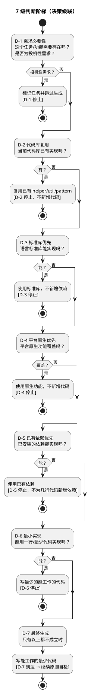

# 判断阶梯（Judgment Ladder）：先尝试不写代码

> 本文件为自定义步骤 `judgment_ladder` 的指令文件（reference 型）。仅在执行计划含 `at=pre-codegen` 且 `key=judgment_ladder` 条目时被 Read。
> 定位：**生成前替代方案决策**（是否需要写），与 code-gen-principles.md 的**生成前合规性自检**（怎么写才合规）正交、并行。
> 集成理念来源：Ponytail（agent-portable skill distribution，"lazy senior developer" 哲学）——只借鉴理念与内容，不集成其技能/包/Hook。

---

## 1. 核心哲学

> "You are a lazy senior developer. Lazy means efficient, not careless. The best code is the code never written."

理解问题之后（不是替代理解），代理必须**按严格顺序逐级判断，在第一个成立的梯级停止**。

## 2. 七级判断阶梯



## 3. 决策规则

| 梯级 | 问题 | 停止条件（第一个成立即停止） |
|------|------|------------------------------|
| D-1 | 需求必要性 | 该任务是投机性需求（非设计文档要求、非用户请求） |
| D-2 | 代码库复用 | 当前代码库已有同类实现（helper/util/pattern） |
| D-3 | 标准库优先 | 语言标准库能实现 |
| D-4 | 平台原生优先 | 平台原生功能覆盖（浏览器原生元素 / CSS 能力 / 系统 API） |
| D-5 | 已有依赖优先 | 已安装的依赖能实现 |
| D-6 | 最小实现 | 能用一行/最少代码实现 |
| D-7 | 最终生成 | 以上都不成立 → 写能工作的最少代码 |

## 4. 与设计文档的关系（重要约束）

| 约束 | 说明 |
|------|------|
| **D-1 仅适用"可选"任务** | 设计文档标记为"可选"或"未来扩展"的任务，才可被 D-1 拦截 |
| **设计明确要求的功能** | D-1 **不适用**，直接从 D-2 开始（设计文档明确要求的功能必须实现） |
| **记录判断结果** | D-2~D-6 的判断结果必须在任务完成备注中记录（格式见第 6 节） |

## 5. 安全底线（D 级判断永不简化）

以下 6 类内容**任何梯级都不得简化**：

1. 信任边界的输入验证
2. 防止数据丢失的错误处理
3. 安全措施
4. 无障碍基础
5. 设计文档明确要求的功能
6. 用户明确请求的任何内容

## 6. 输出格式

```markdown
判断阶梯: D-X — [替代方案说明]
→ 跳过代码生成 / → 继续原则自检
```

示例：
- `判断阶梯: D-2 — 复用现有 utils/date_format.py 的 format_date() → 跳过代码生成`
- `判断阶梯: D-3 — 使用标准库 datetime.fromisoformat() → 跳过代码生成`
- `判断阶梯: D-7 — 无替代方案 → 继续原则自检 C-1~C-15`

## 7. 与现有环节的协同

| 环节 | 协同方式 |
|------|---------|
| **9.4 原则自检** | D-7 到达才进入；D-1~D-6 停止则跳过生成（不产生需修复的产物） |
| **L4 审查（若同时启用）** | 条件化 CHECK-R14.3：检查任务备注中是否含"判断阶梯: D-X"记录、D-1~D-6 停止的任务是否确实跳过生成、D-7 到达的任务是否确实生成、D-2/D-3/D-4 是否应拦截却生成了重复实现/不必要依赖。安全底线被错误简化 → ERROR，其余 → WARNING。仅当执行计划同时包含 `l4_review` 与 `judgment_ladder` 时适用 |

## 8. 可选参考：platform-native 查找表（D-3/D-4 建议参考）

```
HTML 原生元素: <input type="date"> / <dialog> / <details> / <summary>
CSS 能力: clamp() / prefers-color-scheme / :has() / aspect-ratio
JS API: URLSearchParams / structuredClone() / crypto.randomUUID() / Intl.*
语言标准库: Python datetime.fromisoformat() / zoneinfo / functools.cache
数据库: LIMIT/OFFSET / 递归 CTE / UNIQUE 约束 / 窗口函数
```
