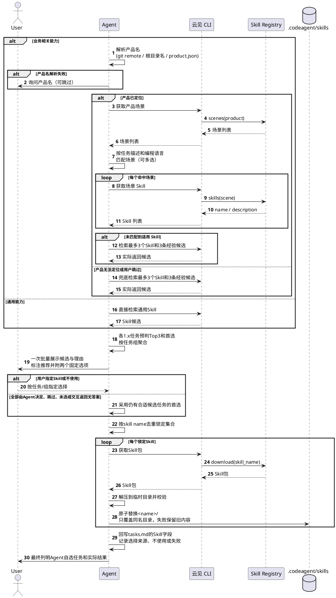

# tasks.md 结构指导 + 锚点提取规范（B 档指令文件）

> 本文件为 Phase 8 生成设计文档时的 **tasks.md 结构指导 + 设计锚点自动提取规范**。无条件加载（Phase 8 核心产物生成必读），与可配置步骤开关无关。

## 8.4 单仓 tasks.md 结构

**重要**：tasks.md 必须按照以下结构组织：

**单仓与多仓一致，tasks.md 仅包含"代码生成任务"章节（即下方 1.x 任务），不包含"Code Review 任务"和"单元测试任务"章节。原因：Code Review（Step 11）与单元测试（Step 12）由 core-apply 固定流程驱动（与多仓 M-4/M-5 一致），不再从 tasks.md 识别任务。包含这些任务会导致：status 脚本误判 blocked、完成率虚低、执行 Agent 越界。**

```markdown
## 代码生成任务

- [ ] 1.1 <任务描述>
  - **编程语言**: <java/cpp/go/python/javascript/typescript/other>
  - **关联需求**: <需求ID>
  - **验收标准**: <完成标准>
  - **设计锚点**: <#3.1 #2.2 #1.1:约束 #1.2:证据驱动>  # 自动提取/手动填写
```

**TDD 模式（测试策略为 `tdd`）三字段**：每个代码生成任务在"设计锚点"后追加三个字段，由派生脚本 `scripts/tasks_tdd_deriver.py` 在生成后自动注入（core-design 需在 delta_test_design.md 确认完整后、调用派生脚本前，为每任务填好真实值）：

```markdown
- [ ] 1.1 <任务描述>
  - **编程语言**: <java/cpp/go/python/javascript/typescript/other>
  - **关联需求**: <需求ID>
  - **验收标准**: <完成标准>
  - **设计锚点**: <#3.1 #2.2 #1.1:约束 #1.2:证据驱动>
  - **覆盖用例**: <TC001, TC002, ...（来自delta_test_design.md）>
  - **测试文件路径**: <项目测试工程中的精确路径>
  - **测试命令**: <本地命令 或 远程命令 或 不执行编译>
```

> **填写要求**：`测试文件路径` 和 `测试命令` 必须按项目实际结构写死，不得留占位符。`覆盖用例` 必须覆盖 delta_test_design.md 中全部 TC（派生脚本自检会校验，未覆盖则报错终止）。

## 任务能力关联：候选 → 批量确认 → 下载 → 回写

读取本 Skill 的 SKILL.md「Skill 与经验消费规则」，在 1.x 任务形成后执行下列步骤。保留任务编号、checkbox、锚点和 TDD 字段；tasks.md 是唯一任务能力关联数据源，不另建候选或选用索引。

### 主流程

1. **产品与场景（仅业务相关能力）**：结合 git remote、仓库根目录名、.codeagent/product.json 解析产品名；无法可靠解析时询问用户，允许跳过。通过云见 CLI 调用 Registry 的 scenes(product) 能力，读取 tasks.md 中任务描述和编程语言，语义匹配相关场景（可多选），再获取每个命中场景的 skills(scene) 名称和描述。通用能力跳过上述产品解析、产品询问和场景链路，直接检索 Skill。

2. **准备候选**：每个 1.x 任务预判最多 Top3 Skill，给出名称、描述、一句话理由及首选。业务路径未命中时沿用最多 3 个 Skill / 3 条经验的兜底检索；通用能力直接检索 Skill。没有结果不凑数、不强选。
3. **一次批量确认**：按任务组展示候选表，向用户发起一次 AskUserQuestion，允许在同一次回答中按任务 / 任务组指定 Skill 或不使用；不逐任务弹窗。候选选项标注「✓ 推荐」及理由，固定附加「全部由 Agent 决定」和「本次不使用外部 Skill」。拟采用的经验也随表展示。
4. **锁定选择**：同一回答冲突时，全局不使用优先于逐任务指定，逐任务指定优先于任务组指定，最后才是默认首选。明确不使用不得回退到推荐项，也不得通过新获取经验绕过。「全部由 Agent 决定」或跳过 / 未选时采用合适的首选；交互工具结束并返回无答案时也按此默认规则处理，不将仍在等待的提问判作无响应。部分任务未指定时仅对这些任务采用默认值。最终输出再列明 Agent 自选任务，不追加逐任务确认。
5. **按名称去重**：扫描本轮已锁定的 Skill 集合，按 skill name 去重后经云见 CLI download(skill_name)。多个任务引用同一名称只下载一次；候选和选择临时保存在会话中，不落独立索引。
6. **项目级安装**：先解压到临时目录，校验名称、路径未越界和内容可读，再原子替换 .codeagent/skills/<name>/；只覆盖本轮锁定的同名 Skill，不动其他目录。失败保留旧目录，不安装半成品、不宣称新包成功可用。
7. **回写任务**：成功后更新每个任务的 Skill 字段，记录实际名称、本地路径及选择来源。明确不使用也写回，以便 core-apply 尊重；无候选、获取失败则如实标注。最后报告选择来源、安装及回写结果。

Registry 的 scenes / skills / download 表示现有接口能力，实际操作始终经云见 CLI，不将下图的逻辑名称当作未经验证的 CLI 命令，也不另建 HTTP 获取入口。CLI 或查询失败时按实际失败状态处理，继续原任务；不能把服务异常冒充无候选或用户跳过。

### 时序



### 批量展示与交互要求

以任务组为单位展示下表；同组选择可以一次应用到多项任务，仍保留逐任务指定入口，多仓时在编号前附仓名。

| 任务组 / 任务 | 编程语言 | Skill 候选 | 推荐及一句话理由 |
|---|---|---|---|
| 订单组：1.1 / 1.2 | Java | order-api、java-service | order-api：✓ 推荐，覆盖订单接口约定 |
| 导入组：1.3 | Python | data-import | data-import：✓ 推荐，符合文件导入任务 |

一次 AskUserQuestion 同时支持按表指定「1.1=order-api；1.2=不使用」等回答，并固定提供「全部由 Agent 决定」「本次不使用外部 Skill」。表格只是展示示例，必须换成真实任务和实际候选，不把例子当作已存在的 Skill。

「本次不使用外部 Skill」适用于本轮展示的全部任务，不再下载或使用其外部 Skill，不通过经验兜底绕过。用户逐任务明确不使用时，同样不能因为未下载而改成 Agent 首选，也不新获取经验绕过。用户指定名称或明确确认推荐记为「用户指定」；委托 Agent 或空答案默认采用首选记为「Agent 自选」。跳过 / 未选 / 工具返回无答案时无需追加确认，按首选继续，最终汇报「Agent 自选」及其任务范围；工具故障需说明而不能伪装成用户跳过。

多仓由各仓执行者只返回候选，主会话合并后一次确认，再分发锁定结果，各仓独立安装和回写。下载包可按名称复用，但安装路径与 Skill 字段仍属于各仓。代码执行阶段先消费已有决定，只有新增 / 改选需求才重新汇总确认。循环中才发现新需求时，先汇总并预检其余待办任务，返回主会话批量准备阶段统一处理，不逐任务临时弹窗。

### Skill 字段回写

保留现有任务字段，在任务下写入实际结果，例如：

```markdown
- [ ] 1.1 实现订单接口
  - **编程语言**: java
  - **Skill**: order-api（.codeagent/skills/order-api/；用户指定）
- [ ] 1.2 实现订单校验
  - **编程语言**: java
  - **Skill**: 不使用（用户选择）
- [ ] 1.3 实现导入
  - **编程语言**: python
  - **Skill**: data-import（.codeagent/skills/data-import/；Agent 自选）
```

此处仅示意 Skill 字段，其余关联需求、验收标准、设计锚点及 TDD 字段必须继续保留。多项 Skill 按项目既有描述格式列明。下载或原子替换失败时不要填成成功路径；如保留旧版关联，须说明新获取失败且验证旧内容仍适用。经验继续按已有任务描述约定记录，不新建映射文件。

## 8.5 设计锚点自动提取（推荐）

生成 tasks.md 时，**强烈推荐**自动提取设计锚点：

**锚点提取流程**：
1. 读取 `delta_design.md` 内容
2. 对于每个代码生成任务（1.1, 1.2 等）：
   - 解析 delta_design.md 中的元数据注释 `<!-- tasks: [1.1, 2.1] -->`
   - 查找任务关联的章节锚点
   - 提取该章节的关联关键词（如约束、原则等）
3. 自动生成锚点字符串：`#3.1 #2.2 #1.1:约束 #1.2:证据驱动`

**锚点格式规范**：
| 锚点类型 | 格式 | 示例 |
|---------|------|------|
| 章节锚点 | `#X.X` | `#3.1` → 第3.1章详细设计 |
| 关键词锚点 | `#X.X:关键词` | `#1.1:约束` → 1.1节中"约束"相关内容 |
| 通配符锚点 | `#4.x:*` | `#4.x:审查` → 4.x节所有子章节中含"审查"的内容 |

**锚点优先级**：
| 优先级 | 锚点类型 | 说明 |
|--------|---------|------|
| P0 | `#3.x` 详细设计章节 | 必须参考，直接决定代码实现 |
| P0 | `#2.1` `#2.2` 架构锚点 | 必须参考，影响代码组织结构 |
| P1 | `#1.1:约束` 约束锚点 | 必须参考，避免违反非目标 |
| P1 | `#1.2:原则名` 原则锚点 | 必须参考，影响实现质量标准 |
| P2 | `#4.x:流程名` 流程锚点 | 建议参考，影响业务逻辑走向 |

**自动提取示例**：
```python
# 使用 anchor_extractor.py 自动提取
from anchor_extractor import extract_anchors_by_task

delta_design_path = "docs/changes/<change>/delta_design.md"
task_1_1_anchors = extract_anchors_by_task(delta_design_path, "1.1")
# 返回: ['#3.1', '#2.2', '#1.1:约束', '#1.2:证据驱动', '#1.2:不信任']

# 在 tasks.md 中填入
- [ ] 1.1 开发 explore-doc-reviewer Skill
  - **设计锚点**: #3.1 #2.2 #1.1:约束 #1.2:证据驱动 #1.2:不信任
```
