# CoreSpec 全流程动态编排框架 — 开发者指导

**版本**：v1.1 | **日期**：2026-11-02 | **适用对象**：CoreSpec 框架开发人员（修改/新增 `core-*` skill 的可配置步骤、固定步骤、自定义步骤、编排点等）

> v1.1（2026-11-02）：确认机制删除后的 run_build 数据流、输出契约、run_fragment 落盘语义、apply_dependency_rules 三条规则、5 skill 注册表核验数字、骨架行数刷新。

---

## 0. 本文要解决什么

本文面向**修改 CoreSpec 框架本身**的开发人员，回答以下高频问题：

- 我要**新增一个可配置内置步骤**（让用户能开关某个阶段），从哪里入手？
- 我要**修改固定步骤**（恒执行、不可关的步骤），要注意什么？
- 我要**加入自定义步骤**（用户配置文件里注入的 reference/skill 步骤），怎么挂载？
- 我要**新增编排点插槽**（让自定义步骤能挂在某个阶段前后），怎么注册？
- 我要**新增/修改依赖规则**（A 关闭则 B 自动降级），怎么写？
- 我要**新增一个全新的 core-* skill**（接入动态编排框架），完整流程是什么？
- 我要**骨架化** SKILL.md / multi-repo.md（把细节抽到 references/），怎么对齐标杆？

本文与已有文档分工：

| 文档 | 定位 |
|------|------|
| `coreharness-spec/skills/core-shared/references/flow-config-guide.md` | **用户面**指南：怎么用 `~/.corespec/flow-config.json` 启停步骤、加自定义步骤 |
| `docs/skeleton-core-<skill>.md`（5 份） | **单 skill 改造方案**：每个 skill 的可配置化分析、抽离评估、验收清单 |
| **本文（`docs/corespec-dev-guide.md`）** | **框架面**开发者指导：修改框架注册表/规则/骨架的统一入口 |

---

## 1. 全景视图：动态编排框架的分层

CoreSpec 动态编排框架分**三层**，理解分层是做任何修改的前提：

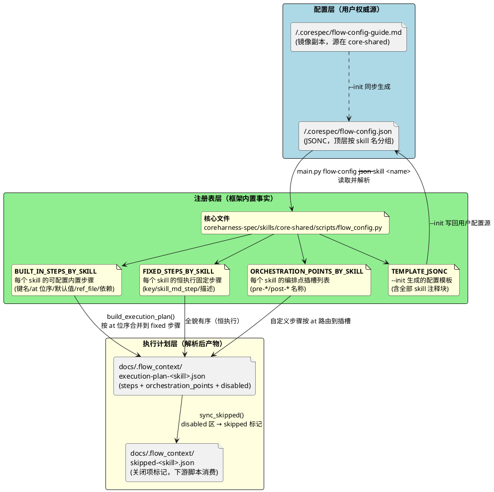

**关键不变量**：

1. **配置源是用户权威**：`flow-config.json` 里的声明是用户意图，执行计划只是"最终解析状态"，不反向写回配置源（用户直接编辑配置文件调整，框架只读）。
2. **注册表是框架事实**：哪些键可配置、at 位序是什么、默认值、依赖关系，全部在 `flow_config.py` 注册表里声明，不读 SKILL.md。
3. **执行计划是消费方权威**：SKILL.md/脚本只读 `execution-plan-<skill>.json`，不重新解析配置源。

---

## 2. 核心数据结构总览

修改框架前必须先看清三大注册表的数据结构。以 `core-archive` 为例：

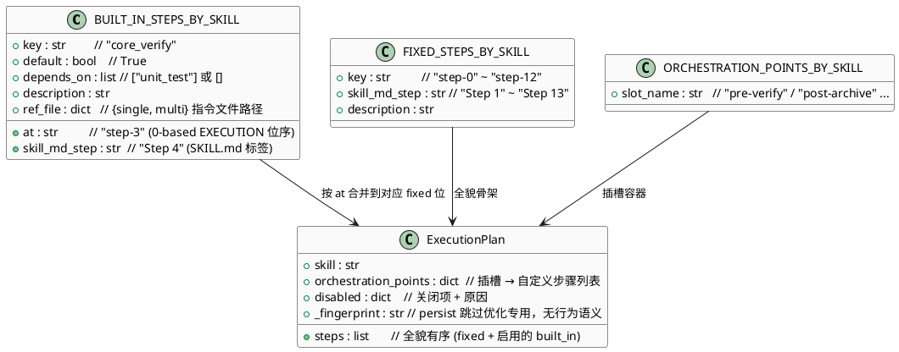

### 2.1 `at` 位序编号约定（极易出错，务必牢记）

`at` 字段使用 **0-based EXECUTION 位置**。core-apply 的 steps.md 从 0 起编号，直接取序号；其余连续编号从 1 起时换算公式为：

```
at = "step-N" 其中 N = steps.md 序号 − 1 = SKILL.md Step 编号 − 1（连续编号时）
```

各 skill 编号约定：

| skill | SKILL.md 编号 | steps.md 序号 | at 换算 |
|-------|--------------|--------------|---------|
| core-apply | Step 0~15（连续） | 0~15 | step-N = Step N（steps.md 同样从 0 起） |
| core-init | Step 0/1/2/4/5/6a/6b（跳跃） | 1~7 | step-N = steps.md 序号 − 1 |
| core-explore | Step 0 + 阶段1~11（混合） | 1~15 | step-N = 阶段编号 − 1 |
| core-design | Phase 1~12（连续） | 1~12 | step-N = Phase 编号 − 1 |
| core-archive | Step 1~13（连续） | 1~13 | step-N = Step N − 1 |

**反例（典型错误）**：core-archive 的 `core_verify` 对应 SKILL.md "Step 4"，新手可能写成 `at: "step-4"`，但实际正确值是 `at: "step-3"`（0-based）。

---

本仓 `skill_consumption` 已在 core-design Phase 9（`at=step-8`）和 core-apply Step 9（`at=step-9`）注册为默认关闭的内置步骤。对应阶段后移，编排点名称保持不变。apply 多仓通过独立的 M-1a 环节准备任务上下文，使用 `ref_file.multi=references/skill-consumption-multi.md`；子代理只读本仓片段的多仓控制信息。

## 3. 修改可配置内置步骤（BUILT_IN_STEPS_BY_SKILL）

### 3.1 什么时候改这里

当某个固定步骤需要变成**用户可开关**时（例如把 core-verify 从"永远执行"改成"用户可关"），就改这里。

### 3.2 修改流程

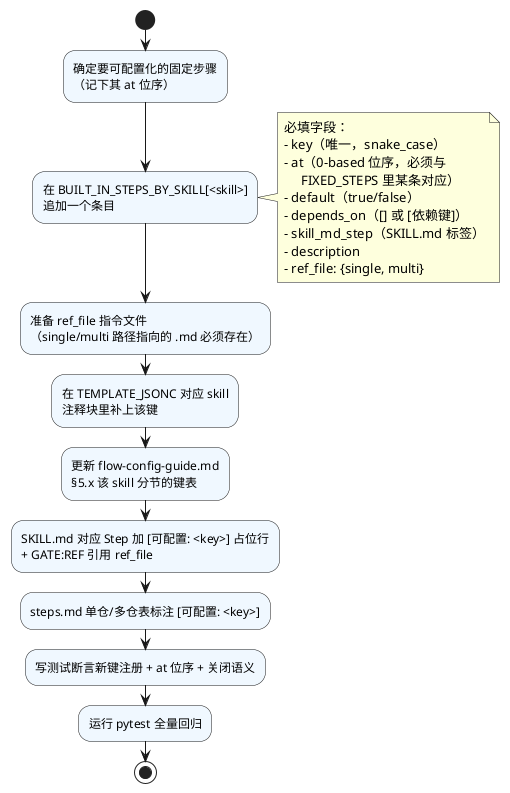

### 3.3 ref_file 策略：通道型 vs 内容型 vs 单文档承载

这是最容易遗漏的决策点。决定 `ref_file.single` 与 `ref_file.multi` 是否相同：

| 类型 | 判定 | ref_file 策略 | 示例 |
|------|------|--------------|------|
| **通道型** | 单仓/多仓执行模式不同（子代理并行模板/并发规则/汇总逻辑差异大） | `single != multi`，multi 指向独立 `*-multi.md` | core_verify / spec_sync / design_traceability |
| **内容型** | 单仓/多仓差异仅在路径或检测方式 | `single == multi`，同一文件内分节区分多仓 | version_check / check_artifacts / check_tasks |
| **单文档承载标杆** | 单仓/多仓逻辑高度统一，文件内有"5.2 多仓"专节 | `single == multi`，文件内显式分节 | backfill |

**决策口诀**：模板/并发/汇总逻辑不同 → 通道型；只是路径/检测方式不同 → 内容型；逻辑完全统一 → 单文档承载。

### 3.4 depends_on 依赖规则

声明 `depends_on: ["unit_test"]` 后，**框架会自动**：

1. `unit_test` 关闭 → 该步骤自动降级跳过（`disabled_by_config` + `dependency_downgraded`）
2. `disabled_zone` 记录 `dependency_of: "unit_test"`、`auto_downgraded: true`

但**硬编码的依赖规则**在 `apply_dependency_rules()` 函数里（如 core-apply `l5_coverage↔unit_test`、core-init `execute_sync↔check_sync`），新增非平凡依赖时可能需要在此函数补一条 if 分支。`depends_on` 字段声明用于元数据展示，**真正的级联跳过逻辑看 `apply_dependency_rules`**。

### 3.5 自定义步骤的依赖（depends_on + dependency_type）

自定义步骤也可声明 `depends_on: ["unit_test"]` 和 `dependency_type: "hard"`：

- `dependency_type: "hard"`（默认）：依赖关闭则该自定义步骤整个跳过
- `dependency_type: "soft"`：依赖关闭仍执行（自定义步骤自行处理缺失输入）

---

## 4. 修改固定步骤（FIXED_STEPS_BY_SKILL）

### 4.1 什么时候改这里

- 新增一个**恒执行、不可关**的步骤（如 core-archive Step 7 "获取各仓目录"——多仓专属但不可关）
- 删除/合并某个固定步骤
- 修改步骤描述（`description`）

### 4.2 修改流程

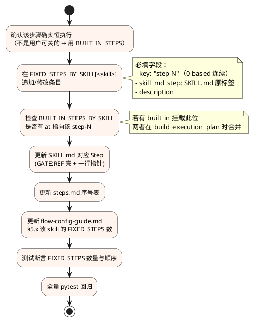

### 4.3 固定步骤与可配置步骤的合并机制

`build_execution_plan()` 会遍历 `FIXED_STEPS`，对每个 `step-N` 检查是否有 `BUILT_IN_STEPS` 的 `at` 指向它：

- 有且启用 → 该步骤升级为 `type: "built_in"`，携带 `config_key` + `ref_file`
- 有但关闭 → 降为 `type: "fixed"` + `enabled: false`，**不携带 config_key/ref_file**
- 无 → 保持 `type: "fixed"` + `enabled: true`

**关键**：`at` 位序必须与 `FIXED_STEPS` 的 key 严格对应，否则 built_in 步骤会"悬空"无法挂载。

### 4.4 不可关闭步骤的特殊语义

某些固定步骤在多仓模式下对应"M 阶段"（如 core-archive Step 11 → M-3 归档），这些 M 阶段不可关闭。实现方式：**不给该步骤注册 built_in 键**，它就永远是 `fixed enabled=true`。多仓的强制位豁免声明写在 `multi-repo.md` 的"强制位豁免总表"里。

---

## 5. 加入自定义步骤（用户配置文件注入）

### 5.1 自定义步骤的两种类型

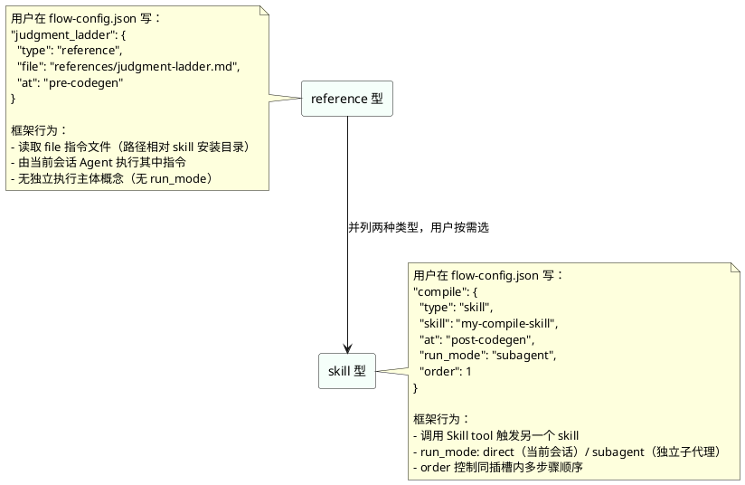

### 5.2 字段校验规则（`validate_custom_step`）

| 字段 | reference 型 | skill 型 |
|------|-------------|----------|
| `type` | 必填 `"reference"` | 必填 `"skill"` |
| `file` | 必填，指令文件路径 | ❌ 不允许 |
| `skill` | ❌ 不允许 | 必填，目标 skill 名 |
| `at` | 必填，必须是该 skill 的编排点 | 必填，必须是该 skill 的编排点 |
| `run_mode` | ❌ 不允许（报错） | 可选，`direct`（默认）/`subagent` |
| `order` | 可选整数 | 可选整数 |
| `description` | 可选 | 可选 |
| `depends_on` | 可选数组 | 可选数组 |
| `dependency_type` | 可选 `hard`/`soft` | 可选 `hard`/`soft` |
| `args` | ❌ 已移除（报错） | ❌ 已移除（报错） |

**反例**：reference 型填了 `run_mode` → 报错"reference 型不支持 run_mode"；填了 `args` → 报错"args 已移除，业务输入请在 skill 内自包含配置"。

### 5.3 软启停：JSONC 手工注释

用户不想用某个自定义步骤时，**直接把声明整块注释掉**（JSONC 支持 `//`），不删除——下次取消注释即恢复：

```jsonc
{
  "core-apply": {
    "version_check": true,
    // "judgment_ladder": {        // ← 被注释掉，不参与解析与执行计划
    //   "type": "reference",
    //   ...
    // }
  }
}
```

框架侧支持：`list_active_custom_steps()`（run_build 输出 `active_orchestration_entries` 字段）只列生效步骤；`list_commented_custom_steps()`（输出 `commented_custom_steps` 字段）扫描被注释的声明（基于 JSONC 文本扫描的块提取，支持注释形态），供 SKILL.md 提示"你有 N 个已注释待恢复的步骤"。开发者注意：这两个函数读的是 JSONC 文本而非 JSON 解析结果，用户手工注释格式多样（整块 `//` 前缀），扫描逻辑要覆盖多行块注释形态。

### 5.4 自定义步骤的开发者侧工作

如果**用户能挂载自定义步骤到某个新位置**，开发者需要：

1. 在 `ORCHESTRATION_POINTS_BY_SKILL[<skill>]` 注册新的插槽名（如 `post-archive`）
2. 在 `flow-config-guide.md` §5.x 该 skill 的编排点表里列出该插槽
3. 在 `TEMPLATE_JSONC` 该 skill 注释块的 `at` 提示里补上该插槽名
4. 在 SKILL.md 对应 Step 的描述里说明"此处可挂自定义步骤"
5. 测试：`validate_custom_step` 对新插槽的 `at` 校验通过；`allowed_at()` 返回含新插槽

---

## 6. 编排点插槽（ORCHESTRATION_POINTS_BY_SKILL）

### 6.1 编排点的粒度（极易混淆）

**编排点是 sub-step 级，不是 step 级**。它不是"在第 N 步前后插入一个新步骤"，而是"在某个 step 内部或两个 step 之间插入一个钩子"。

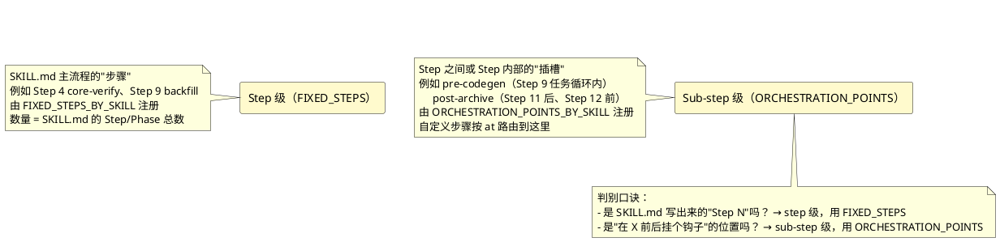

### 6.2 现有 skill 的编排点一览

| skill | 编排点数 | 插槽示例 |
|-------|---------|---------|
| core-apply | 5 | pre-codegen / post-codegen / post-l4 / post-review / post-ut |
| core-init | 5 | post-init-structure / post-scan-language / post-multi-analysis / pre-execute-sync / post-execute-sync |
| core-explore | 9 | pre-clarification / post-clarification / pre-proposal / post-proposal / pre-delta-spec / post-delta-spec / post-l1 / post-review / post-cleanup |
| core-design | 8 | post-rule-fetch / post-gather-context / post-code-understanding / pre-generate / post-generate / post-traceability / post-design-review / post-cleanup |
| core-archive | 10 | pre-verify / post-verify / pre-backfill / post-backfill / pre-spec-sync / post-spec-sync / pre-archive / post-archive / pre-push / post-push |

### 6.3 新增编排点的注意事项

- 插槽名**全 skill 唯一**（不能跨 skill 重名，否则 `SLOT_LABELS` 字典会冲突，`_slot_label()` 用 `skill:slot` 前缀消歧）
- 插槽名要语义化（`pre-archive` 比 `before-step-11` 好）
- `SLOT_LABELS` 字典要补上中文化标签（输出摘要里展示）
- `build_summary` 会自动消费新插槽，无需额外接线

---

## 7. 构建执行计划（配置为唯一事实源，2026-10-31 简化）

### 7.1 数据流（零确认）

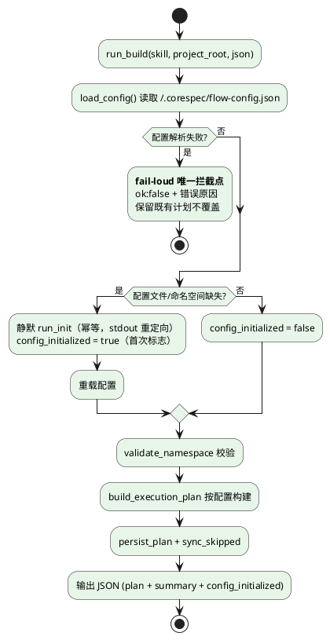

**心智模型（对齐模板自定义模式）**：配置文件 = 唯一事实源。没有配置 = 全默认；改了配置 = 按改后的执行；配置写错 = fail-loud 报错（唯一拦截点）。执行计划文件（execution-plan-*.json）是每次运行开头从配置重建的**派生缓存**——同会话后续环节（run_fragment 等）读它，但它刚被配置刷新过，二者不分叉。

### 7.2 run_build 输出契约（JSON 字段全表）

`run_build(--json)` 成功时的输出字段（SKILL.md 按内容判断，exit code 恒 0）：

| 字段 | 类型 | 说明 |
|------|------|------|
| `ok` | bool | true；false 时仅含 `error` 或 `errors`（fail-loud 唯一拦截点） |
| `skill` / `all_default` | str / bool | 命名空间名 / 是否全默认计划 |
| `config_initialized` | bool | 本次运行静默补齐了配置文件或命名空间（首次标志，SKILL.md 总结加一行提示） |
| `plan_path` / `skipped_path` | str | 派生文件落盘路径 |
| `summary` | str | build_summary 生成的人话摘要 |
| `plan` | dict | 执行计划本体（steps / orchestration_points / disabled / \_fingerprint） |
| `active_orchestration_entries` | list | 当前生效的自定义步骤（供展示） |
| `commented_custom_steps` | list | 被注释待恢复的自定义步骤声明（JSONC 文本扫描） |
| `template_initialized` | bool | 本次运行自动初始化了用户级 L2 模板目录（best-effort，失败不影响计划） |

`run_fragment(--fragment --repo X --repo-cwd Y)`：读持久化计划，**总是**写 `docs/.flow_context/execution-plan-fragment-<skill>-<repo>.json`（子代理输入文件，落盘是主行为），`--json` 仅额外镜像同一 JSON 到 stdout；计划不存在或缺 `--repo`/`--repo-cwd` 时输出 `ok:false` 错误。

core-apply 片段额外包含 `built_in_steps.skill_consumption`：`phase` 固定为 `M-1a`，`enabled` 从持久化计划的消费启用状态投影，开启时附带 `ref_file.multi` 对应的 `ref_file`。不复制单仓 `at` 或 Step 编号，`plan_path` 仅记录来源；M-1a 和 M-2 使用该片段独立判断消费启停。关闭时不携带消费指令路径，自定义插槽保持独立。其他技能片段格式不变。

### 7.3 已删除的确认机制（开发者必读，防回潮）

以下机制已整体删除（2026-10-31 体验简化，方案见 docs/flow-config-ux-optimization.md）：

- `detect_scenario()` 场景检测（A/B/C/D/E）与 `scenario`/`confirm_required`/`config_missing`/`ns_missing` JSON 输出字段——全部移除，只保留 `config_initialized`
- AskUserQuestion 确认/Adjust 模板、空应答处理、多选操作键提示——随 SKILL.md 确认块清零
- `run_apply`/`--apply`/`--changes` CLI 及回写链路（update_config_value/remove_config_key/comment_out_config_key/uncomment_config_key）——用户统一通过直接编辑 flow-config.json 调整

### 7.4 开发者修改构建逻辑的注意点

- 配置指纹（`_fingerprint` + `canonical_fingerprint`）仅保留为 persist 跳过优化，**无任何行为语义**，不要据此恢复确认逻辑
- `config_initialized` 标志唯一用途是 SKILL.md 总结中的一行首次提示
- 静默 init 失败必须 best-effort 容错（init 抛异常 → 全默认计划照常构建）
- 新增 skill 接入时照抄 `run_build` 现有数据流，禁止新增确认分支

---

## 8. 骨架化模式（SKILL.md / multi-repo.md）

### 8.1 为什么要骨架化

SKILL.md 是 Agent 执行时首先读取的文件。如果含大量内联子代理模板/脚本细节/汇总逻辑，会：

- 占用 Agent 上下文窗口
- 修改细节时要改 SKILL.md（高频文件）
- 单仓/多仓逻辑混杂

骨架化的目标：SKILL.md 只保留**步骤占位行 + GATE:REF 壳 + 一行 Execution 指针**，细节全部抽到 `references/*.md`。

### 8.2 骨架化的标杆行数（2026-11-02 实测）

| skill | SKILL.md 行数 | multi-repo.md 行数 |
|-------|--------------|--------------------|
| core-apply | 350 | 205 |
| core-init | 306 | — |
| core-explore | 472 | — |
| core-design | 352 | 180 |
| core-archive | 260 | 107 |

SKILL.md 维持在 260~472 行区间；超过 500 行即触发骨架化审视（实心内容抽 references/）。core-explore 472 行偏高（阶段多），新 skill 以 350 行为软目标。

### 8.3 骨架化模式（GATE:REF 壳）

每个固定/可配置步骤的 SKILL.md 写法：

```markdown
4. **Run core-verify to validate implementation [可配置: core_verify]**

   > 本步骤为可配置步骤。执行与否以执行计划为准：
   > - 执行计划 steps 数组含 `config_key=core_verify` 条目 → 按 ref_file 执行
   > - 执行计划不含本步骤 → 直接进入 Step 5

   **单仓模式**：
   <!-- GATE:REF references/verify-result-handling.md -->
   **MANDATORY GATE**: 本步骤执行前必须 Read 本 SKILL 所在目录下的
   `references/verify-result-handling.md`（完整执行指令：...）。
   绝对路径 = config_dir / 'skills/core-archive/references/verify-result-handling.md'。
   文件不存在时 MUST STOP，禁止跳过。
   读取后输出: "GATE PASSED: references/verify-result-handling.md loaded"。
   <!-- /GATE:REF -->

   **多仓模式**：M-0 子代理并行执行，指令文件为 `references/verify-multi.md`，
   详见 references/multi-repo.md M-0 节。
```

### 8.4 multi-repo.md 的 M 节骨架化

每个 M 节（多仓阶段）写法：

```markdown
## M-0: 多仓core-verify并行执行 **[可配置: core_verify]**

**Replaces**: 单仓 Step 4（core-verify）
**Input**: 多仓路由结果 + 各仓 change 目录

<!-- GATE:REF references/verify-multi.md -->
**MANDATORY GATE**: 进入 M-0 前必须先 Read `references/verify-multi.md`
（M-0 完整执行指令：subagent 强制、子代理任务描述模板、并发上限 3、汇总逻辑）。
<!-- /GATE:REF -->

**Execution**: 完整执行指令见 **references/verify-multi.md**（本 M 阶段唯一执行权威）。

**Output**: 各仓 core-verify 结果按 direction 分桶（UNDER_IMPL 阻塞 / DOC_STALE 交反刷）
**Checkpoint**: UNDER_IMPL CRITICAL 必须解决或用户确认才能进入 M-1
```

### 8.5 三层声明（multi-repo.md 必备）

骨架化的 multi-repo.md 必须包含三层声明，让 Agent 看清多仓模式的全貌：

1. **头部声明节**（`## 可配置步骤与编排点（多仓模式）`）：列出哪些 M 阶段可关、哪些不可关、编排点插槽
2. **强制位豁免总表**（`## 强制位豁免总表（M 关闭时）`）：M-0/M-1/M-2/M-4 关闭时各自的 subagent 强制位/并发规则/汇总逻辑同步豁免
3. **节头标记**：每个 M 节标题带 `**[可配置: <key>]**` 或 `**[不可关闭]**`

### 8.6 骨架化抽离决策（按内容类型）

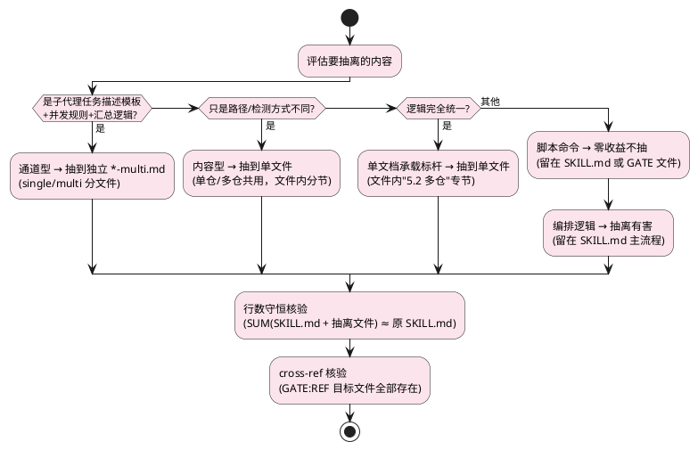

---

## 9. 新增一个全新的 core-* skill（完整流程）

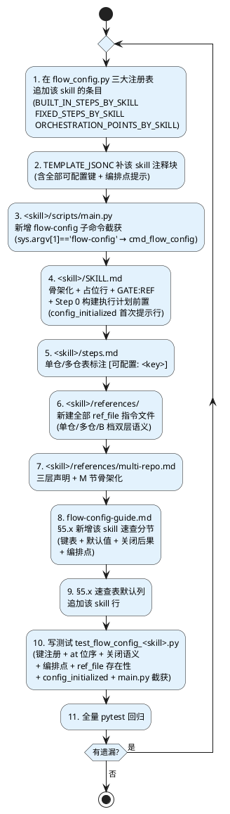

### 9.1 详细检查清单

**注册表（flow_config.py）**：

- [ ] `BUILT_IN_STEPS_BY_SKILL[<skill>]` 每个键含 7 字段（key/at/default/depends_on/skill_md_step/description/ref_file）
- [ ] `at` 位序使用 0-based EXECUTION 位置（不是 SKILL.md Step 编号）
- [ ] `ref_file.single` 和 `ref_file.multi` 路径决策（通道型/内容型/单文档承载）
- [ ] `FIXED_STEPS_BY_SKILL[<skill>]` 步骤数 = SKILL.md Step 总数，`skill_md_step` 保留 SKILL.md 原标签
- [ ] `ORCHESTRATION_POINTS_BY_SKILL[<skill>]` 插槽名全 skill 唯一，语义化命名
- [ ] `TEMPLATE_JSONC` 该 skill 注释块含全部可配置键 + 编排点提示 + 自定义步骤示例

**main.py 截获**：

- [ ] `sys.argv[1] == 'flow-config'` 拦截，调用 `cmd_flow_config`
- [ ] `cmd_flow_config` 委托给 `core-shared/scripts/flow_config.py`：`--init`→`run_init`、`--fragment`→`run_fragment`、默认→`run_build`；`--describe`/`--guide` 由 `cmd_flow_config` 内联调用 `describe_schema()`/`load_guide_text()`（无独立 run_describe/run_guide 函数）
- [ ] 无硬编码 `_APPLY_SCRIPTS_DIR`（统一 `from cc_paths import setup_core_paths` 动态解析）

**SKILL.md**：

- [ ] Step 0（前置）：构建执行计划（`main.py flow-config --json --skill <name>`），JSON 内容判断（非零 exit code 不意味失败）
- [ ] `ok: true` 直接按计划执行（零确认）；`config_initialized: true` 时总结加一行首次提示；`ok: false` fail-loud 停止
- [ ] TaskCreate 强制位（计划解析成功后立即生成任务清单）
- [ ] 每个可配置 Step 标 `[可配置: <key>]` + GATE:REF 壳 + `ref_file` 引用
- [ ] 每个固定 Step 用 GATE:REF 壳（不再含内联脚本/模板）
- [ ] Guardrails 含配置感知措辞（"X 关闭时跳过"而非无条件 ALWAYS）

**steps.md**：

- [ ] 单仓表每个可配置步骤标 `[可配置: <key>]`
- [ ] 多仓表每个 M 阶段标 `[可配置: <key>]` 或 `[不可关闭]`

**references/**：

- [ ] 每个 `ref_file.single` / `ref_file.multi` 指向的文件实际存在
- [ ] 单文档承载标杆文件含"5.2 多仓"专节（如 backfill-from-code.md）
- [ ] 通道型 `*-multi.md` 含完整子代理任务描述模板（含 subagent 强制、并发上限 3、汇总检查点）

**multi-repo.md**：

- [ ] 头部声明节（可配置步骤与编排点）
- [ ] 强制位豁免总表（M-0~M-N 关闭时豁免项）
- [ ] 每个 M 节标题带 `[可配置]/[不可关闭]` 标记
- [ ] 每个 M 节为 GATE:REF 壳 + 一行 Execution 指针（不含内联模板）
- [ ] 依赖链豁免声明（如 core_verify 关闭但 backfill 开启 → M-0→M-1 依赖豁免）

**flow-config-guide.md**：

- [ ] §5.x 该 skill 速查分节含：键表（配置键/对应步骤/默认/关闭后果）+ 编排点列表 + 特殊声明（依赖链豁免 / M 不可关 / GATE 不受控等，按需）
- [ ] 依赖关系保留一句人话（如"关闭 unit_test 会连带关闭 l5_coverage"）

**测试（test_flow_config_<skill>.py）**：

- [ ] 键注册（数量 + at 位序 + 默认值）
- [ ] FIXED_STEPS 数量 + skill_md_step 标签
- [ ] 编排点插槽齐全
- [ ] 每个键的关闭语义（关闭 → 对应 step 降为 fixed enabled=false）
- [ ] M 不可关闭步骤（即使全关仍 fixed enabled=true）
- [ ] 依赖链豁免（A 关闭但 B 开启 → B 仍启用）
- [ ] ref_file 指向文件实际存在
- [ ] run_build 默认/静默 init 行为（config_initialized 首次 true、二次 false）
- [ ] 防回退断言（confirm_required/scenario/config_missing/ns_missing/AskUserQuestion 不再出现于 SKILL.md/guide）
- [ ] main.py 截获 flow-config 子命令
- [ ] TEMPLATE_JSONC 该 skill 注释块合法
- [ ] 文档 cross-ref 一致性（SKILL.md 占位行 + steps.md 标注 + multi-repo.md 三层声明 + guide §5.x）

---

## 10. 依赖规则详解（apply_dependency_rules）

### 10.1 两种依赖机制

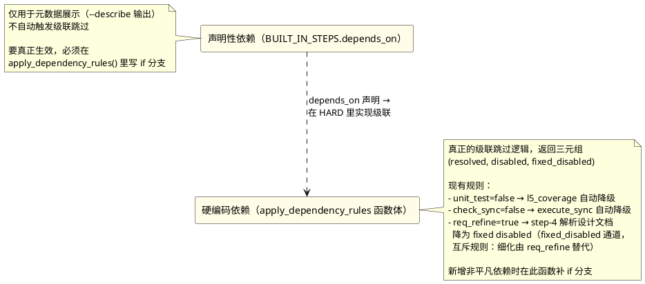

### 10.2 依赖降级的标记

依赖降级后的 step 在 `disabled_zone` 里：

```json
{
  "l5_coverage": {
    "reason": "dependency_downgraded",
    "dependency_of": "unit_test",
    "auto_downgraded": true
  }
}
```

`skipped-<skill>.json` 同步此标记，下游脚本（如 SKILL.md 的"跳过提示"）读 `reason` 区分"用户主动关"vs"依赖自动降级"。

注意 `apply_dependency_rules` 返回**三元组** `(resolved, disabled, fixed_disabled)`：`disabled` 映射 built-in 键（如 l5_coverage），`fixed_disabled` 映射被 built-in 标志连带的**固定步骤键**（如 `req_refine=true` 时的 `step-4`）——后者是"可配置键开/关影响无 config_key 的固定步骤"的唯一通道。

### 10.3 新增依赖规则的步骤

1. 在 `BUILT_IN_STEPS_BY_SKILL[<skill>]` 的步骤条目里声明 `depends_on: ["<parent_key>"]`
2. 在 `apply_dependency_rules()` 函数体里追加 if 分支：
   ```python
   if resolved.get("<parent>") is False and resolved.get("<child>", True):
       resolved["<child>"] = False
       disabled["<child>"] = {
           "reason": REASON_DEPENDENCY_DOWNGRADED,
           "dependency_of": "<parent>",
           "auto_downgraded": True,
       }
   ```
3. 更新 `flow-config-guide.md` 该 skill 分节的依赖链豁免说明
4. 写测试：parent 关闭 → child 自动降级；parent 开启 → child 正常执行

### 10.4 依赖链豁免（多仓 M 阶段间）

多仓模式下 M 阶段间有隐式依赖（M-0 verify → M-1 backfill → M-2 spec-sync → M-3 archive）。框架**不强制级联**——M-0 关闭但 M-1 开启是合法的（依赖链豁免）。这种豁免在 `multi-repo.md` 的"强制位豁免总表"里显式声明，并在 `flow-config-guide.md` 该 skill 分节说明。

---

## 11. 测试要求

### 11.1 测试文件位置

```
coreharness-spec/skills/core-shared/scripts/tests/test_flow_config_<skill>.py
```

所有 skill 的 flow-config 测试集中在 `core-shared/scripts/tests/`（因为 `flow_config.py` 已迁移到 core-shared）。

### 11.2 测试分层

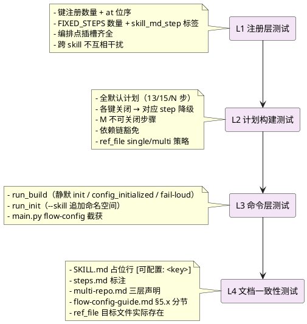

### 11.3 测试运行

```bash
# 单 skill 测试
PYTHONUTF8=1 python -m pytest \
  coreharness-spec/skills/core-shared/scripts/tests/test_flow_config_core_archive.py -v

# 全量回归（修改框架后必跑）
PYTHONUTF8=1 python -m pytest \
  coreharness-spec/skills/core-shared/scripts/tests/ -q
```

Windows 环境务必设 `PYTHONUTF8=1`（否则中文断言会乱码）。

### 11.4 测试断言速查

```python
# 键注册
assert [b["key"] for b in get_built_in_steps("<skill>")] == EXPECTED_KEYS
assert all("single" in b["ref_file"] and "multi" in b["ref_file"] for b in steps)

# at 位序
assert _built_in_step_key_for("step-3", "<skill>") == "core_verify"

# 关闭语义
ns = {"core_verify": False}
plan = build_execution_plan("<skill>", ns)
assert by_key["step-3"]["type"] == "fixed"
assert by_key["step-3"]["enabled"] is False
assert "config_key" not in by_key["step-3"]

# M 不可关闭
ns = {k: False for k in ALL_KEYS}
plan = build_execution_plan("<skill>", ns)
assert by_key["step-10"]["enabled"] is True  # M-3 永远 enabled

# 依赖链豁免
ns = {"core_verify": False}
plan = build_execution_plan("<skill>", ns)
enabled = {e.get("config_key") for e in plan["steps"] if e.get("type") == "built_in"}
assert "core_verify" not in enabled
assert "backfill" in enabled  # 依赖豁免，仍启用

# ref_file 文件存在性
refs_dir = REPO_ROOT / "coreharness-spec/skills/<skill>/references"
for b in steps:
    for path_key in ("single", "multi"):
        rel = b["ref_file"][path_key].replace("references/", "")
        assert (refs_dir / rel).exists()

# 文档 cross-ref
skill_md = (REPO_ROOT / "coreharness-spec/skills/<skill>/SKILL.md").read_text(encoding="utf-8")
for key in EXPECTED_KEYS:
    assert f"[可配置: {key}]" in skill_md
```

---

## 12. 常见陷阱与反模式

### 12.1 at 位序用 SKILL.md Step 编号

**错误**：core-archive 的 `core_verify` 对应 SKILL.md "Step 4"，写成 `at: "step-4"`。
**正确**：`at: "step-3"`（0-based EXECUTION 位置 = Step 编号 − 1）。
**排查**：跑测试 `test_built_in_step_key_for_per_skill_<skill>` 会立即暴露。

### 12.2 ref_file 路径写相对项目工作目录

**错误**：`ref_file: {single: "coreharness-spec/skills/core-archive/references/x.md"}`。
**正确**：`ref_file: {single: "references/x.md"}`（相对 skill 安装目录，框架用 `core_paths` 解析）。

### 12.3 SKILL.md 保留内联子代理模板

**错误**：SKILL.md 的 Step 4 含 60 行子代理任务描述模板。
**正确**：Step 4 是 GATE:REF 壳 + 一行指针，模板抽到 `references/verify-multi.md`。

### 12.4 multi-repo.md M 节保留内联逻辑

**错误**：M-0 节含完整子代理模板 + 并发规则 + 汇总逻辑（40-80 行）。
**正确**：M-0 节是 GATE:REF 壳 + 一行 Execution 指针，模板抽到 `references/verify-multi.md`。

### 12.5 改了注册表忘了改 TEMPLATE_JSONC

**错误**：`BUILT_IN_STEPS_BY_SKILL` 加了新键，但 `TEMPLATE_JSONC` 该 skill 注释块没补。
**后果**：用户 `--init` 生成的配置模板不含新键，看不到能配置。
**修复**：同步更新 `TEMPLATE_JSONC` 注释块 + `flow-config-guide.md` §5.x。

### 12.6 改了注册表忘了改 flow-config-guide.md

**错误**：加了新键/编排点，但 guide 没更新。
**后果**：用户读 guide 看不到新键的说明。
**修复**：guide §5.x 该 skill 速查分节的键表 + 默认值 + 关闭后果 + 编排点都要同步。

### 12.7 改了步骤数忘了改测试

**错误**：`FIXED_STEPS_BY_SKILL[<skill>]` 从 13 步改成 14 步，但测试断言 `len(steps) == 13`。
**修复**：全量 pytest 回归会暴露，但最好改注册表时同步改测试。

### 12.8 跨 skill 命名空间引用

**错误**：core-archive 的 main.py 写 `from core_apply.scripts.flow_config import ...`。
**正确**：所有 skill 都从 `core-shared/scripts/flow_config.py` 导入（已迁移到 core-shared）。
**排查**：`test_no_cross_skill_references` 断言跨 skill 引用清零。

### 12.9 确认语义回潮

**错误**：在 run_build/SKILL.md 恢复 confirm/scenario/AskUserQuestion 确认分支（场景检测已删除，见 §7.3）。
**正确**：配置文件是唯一事实源——缺失静默初始化、修改直接生效、非法 fail-loud，全程零确认；想调整就直接编辑 flow-config.json。

### 12.10 注释声明扫描失效

**错误**：`list_commented_custom_steps` 漏扫用户手工注释的自定义步骤声明（注释格式多样：块提取边界、缩进、尾逗号形态）。
**修复**：该函数基于 JSONC 文本扫描（非 JSON 解析），修改时用真实用户文件形态做测试夹具；无法识别的注释块只是不进 `commented_custom_steps` 提示，不影响计划构建（fail-open 仅限此提示场景）。

---

## 13. 修改检查清单（PR 自查）

提交 PR 前对照此清单：

**注册表**：

- [ ] `BUILT_IN_STEPS_BY_SKILL` / `FIXED_STEPS_BY_SKILL` / `ORCHESTRATION_POINTS_BY_SKILL` 三表同步
- [ ] `at` 位序使用 0-based EXECUTION 位置
- [ ] `ref_file.single` / `ref_file.multi` 决策正确（通道型/内容型/单文档承载）
- [ ] `TEMPLATE_JSONC` 该 skill 注释块同步
- [ ] `apply_dependency_rules` 如有新依赖，已补 if 分支

**指令文件**：

- [ ] 所有 `ref_file` 指向的 `.md` 文件实际存在
- [ ] 单文档承载标杆文件含多仓专节
- [ ] 通道型 `*-multi.md` 含完整子代理模板

**SKILL.md / multi-repo.md**：

- [ ] 可配置 Step 标 `[可配置: <key>]` + GATE:REF 壳
- [ ] 固定 Step 用 GATE:REF 壳（不含内联脚本/模板）
- [ ] multi-repo.md 含三层声明（头部声明节 + 强制位豁免总表 + 节头标记）
- [ ] M 节为 GATE:REF 壳 + 一行指针
- [ ] 行数守恒（SKILL.md 减少行数 ≈ references/ 新增行数）

**steps.md / flow-config-guide.md**：

- [ ] steps.md 单仓/多仓表标注 `[可配置: <key>]` / `[不可关闭]`
- [ ] guide §5.x 该 skill 速查分节齐全（键表 + 编排点 + 关闭后果）
- [ ] guide 各默认值列与注册表 default 一致

**main.py**：

- [ ] `flow-config` 子命令截获（`sys.argv[1] == 'flow-config'` → `cmd_flow_config`）
- [ ] 无硬编码 `_APPLY_SCRIPTS_DIR`（用 `core_paths` 动态解析）

**测试**：

- [ ] `test_flow_config_<skill>.py` 新增/更新断言
- [ ] 全量 `pytest coreharness-spec/skills/core-shared/scripts/tests/ -q` 通过
- [ ] cross-ref 一致性测试通过（SKILL.md + steps.md + multi-repo.md + guide）

---

## 14. 参考实现索引

| 参考 | 位置 | 看点 |
|------|------|------|
| 框架核心 | `coreharness-spec/skills/core-shared/scripts/flow_config.py` | 三大注册表 + `build_execution_plan` + `apply_dependency_rules` + `run_build`/`run_init`/`run_fragment` |
| 用户面指南 | `coreharness-spec/skills/core-shared/references/flow-config-guide.md` | §5.1~§5.5 各 skill 速查分节，§7 常见问题 |
| core-apply 标杆 | `coreharness-spec/skills/core-apply/` | 首个接入动态编排的 skill，7 键 + 15 fixed + 5 编排点 |
| core-init 标杆 | `coreharness-spec/skills/core-init/` | 5 键 + 8 fixed + 5 编排点 + 依赖规则（check_sync→execute_sync） |
| core-explore 标杆 | `coreharness-spec/skills/core-explore/` | 8 键 + 16 fixed（Step 0 + 阶段1~11）+ 9 编排点 + B 档双层语义 + req_refine 互斥 |
| core-design 标杆 | `coreharness-spec/skills/core-design/` | 8 键 + 12 fixed（Phase 1~12）+ 8 编排点 + GATE 不受开关控制 |
| core-archive 标杆 | `coreharness-spec/skills/core-archive/` | 8 键 + 13 fixed + 10 编排点 + 单文档承载标杆（backfill） |
| 骨架化方案 | `docs/skeleton-core-<skill>.md`（5 份） | 每个 skill 的改造方案 + 验收清单 |
| 测试标杆 | `coreharness-spec/skills/core-shared/scripts/tests/test_flow_config_core_explore.py` | 52 个测试覆盖 L1~L4 全部分层（archive 39 / design 36 / init 35） |

---

## 15. 结语

动态编排框架的核心设计原则：

1. **配置源是用户权威**，执行计划只是"最终解析状态"
2. **注册表是框架事实**，SKILL.md/脚本不重新解析配置
3. **执行计划是消费方权威**，下游只读 `execution-plan-<skill>.json`
4. **全貌有序**，计划含全部固定步骤（不只可配置切片）
5. **粒度分层**，step 级（FIXED_STEPS）与 sub-step 级（ORCHESTRATION_POINTS）分离
6. **零接触默认安全**，什么都不配 = 当前行为完全兼容
7. **首次运行静默初始化**，配置/命名空间缺失自动生成并置 `config_initialized` 首次标志，零交互零确认

修改框架时，**先改注册表，再改文档，最后改测试**——这个顺序能避免大部分"注册表改了但文档/测试滞后"的漂移。任何修改完成后必跑全量 `pytest coreharness-spec/skills/core-shared/scripts/tests/ -q`，311 个测试是框架一致性的最后防线。
